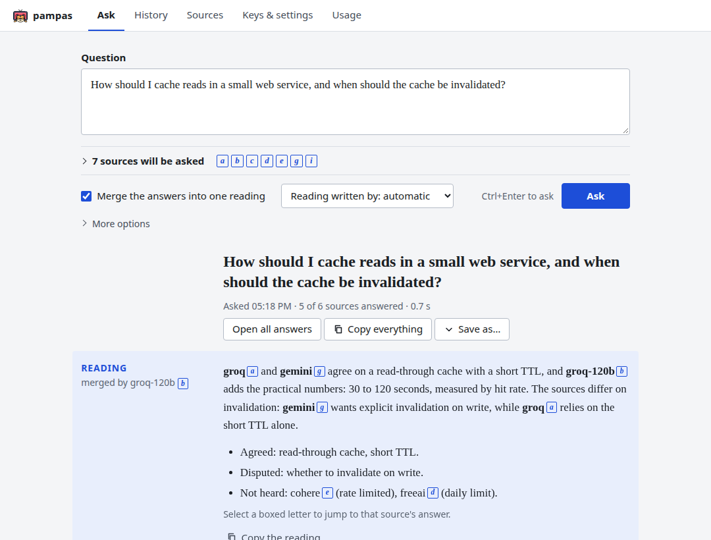
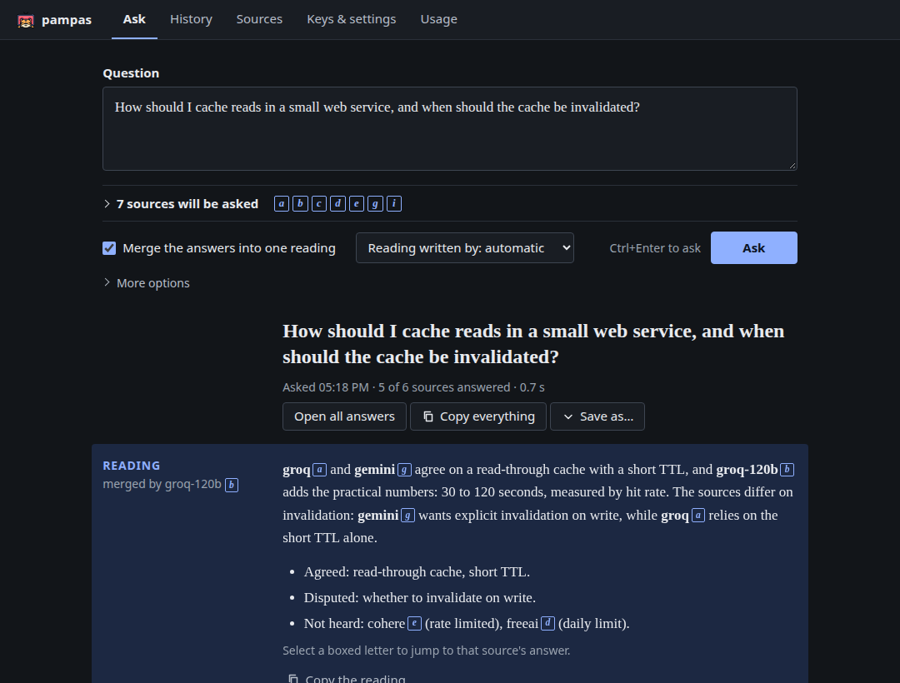
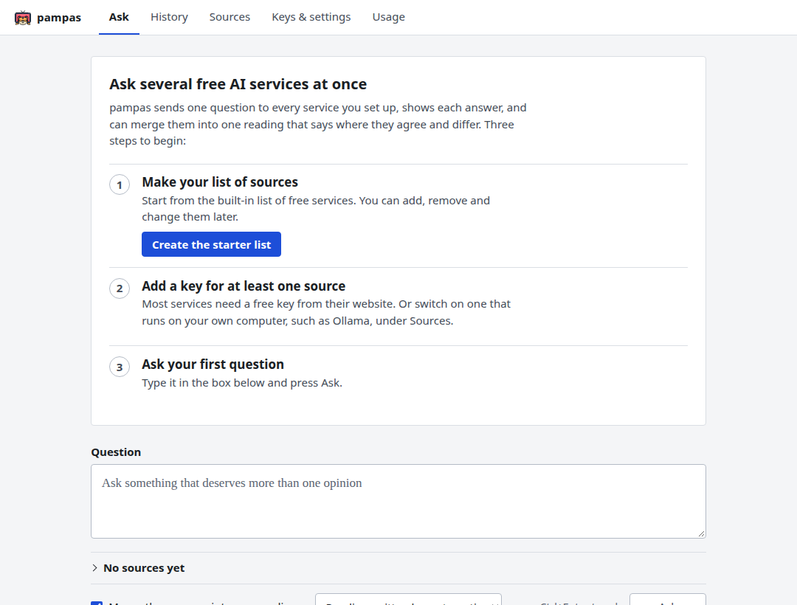
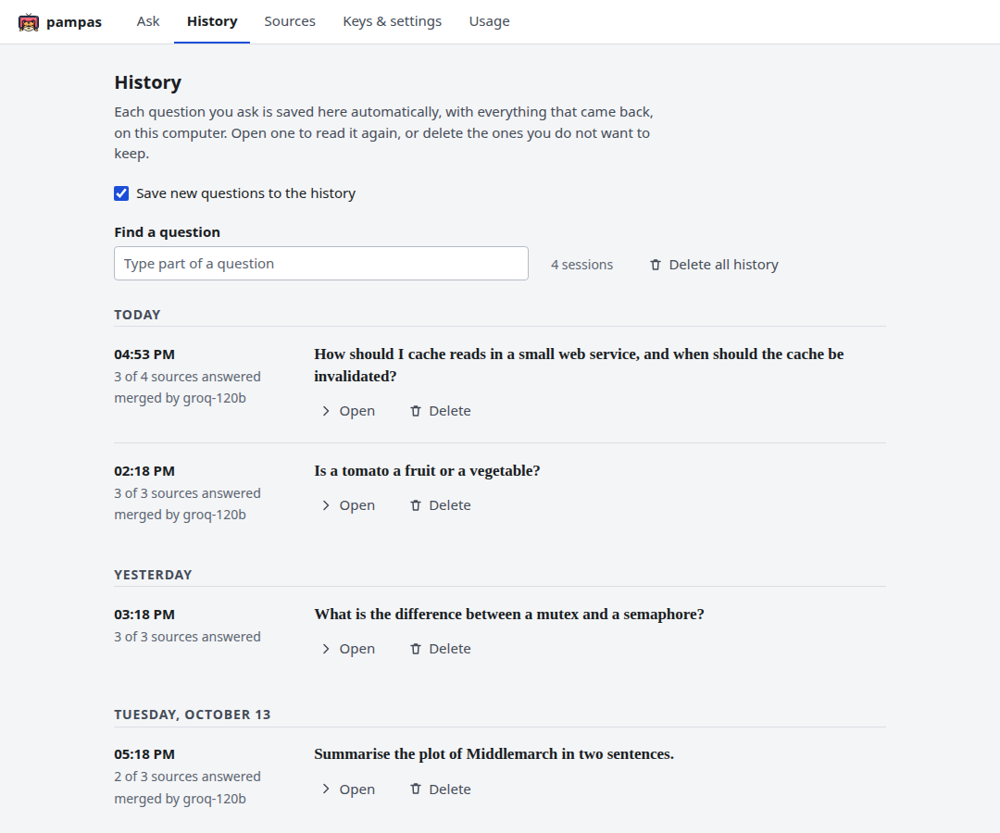
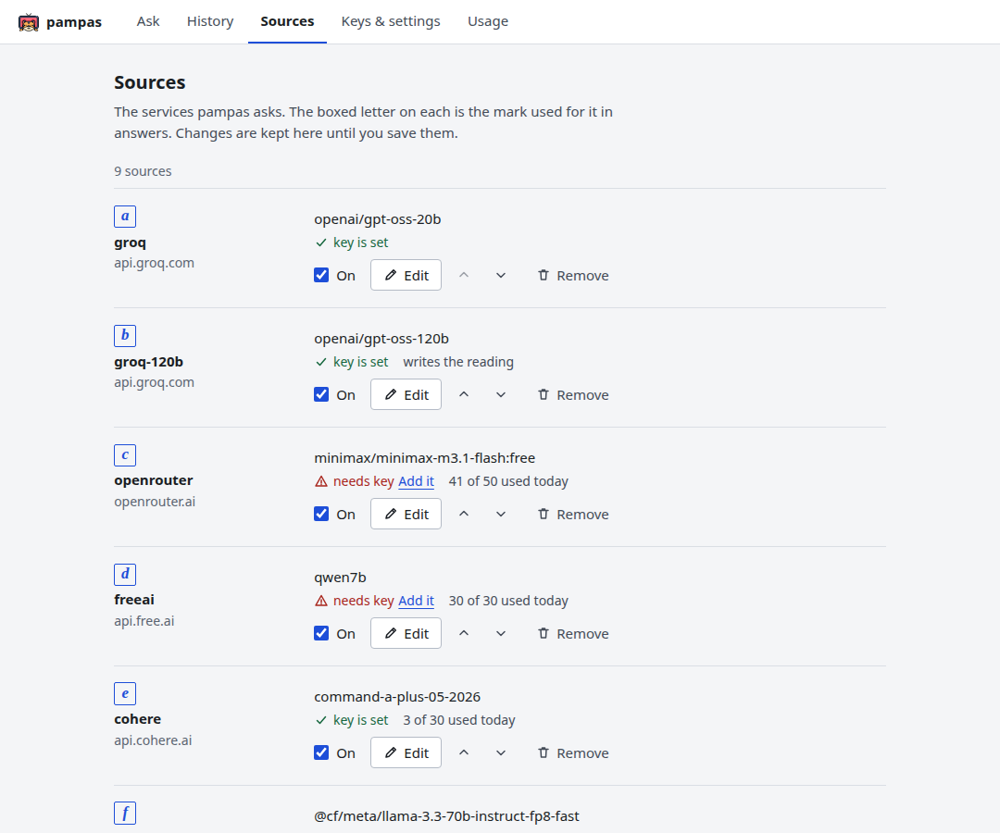
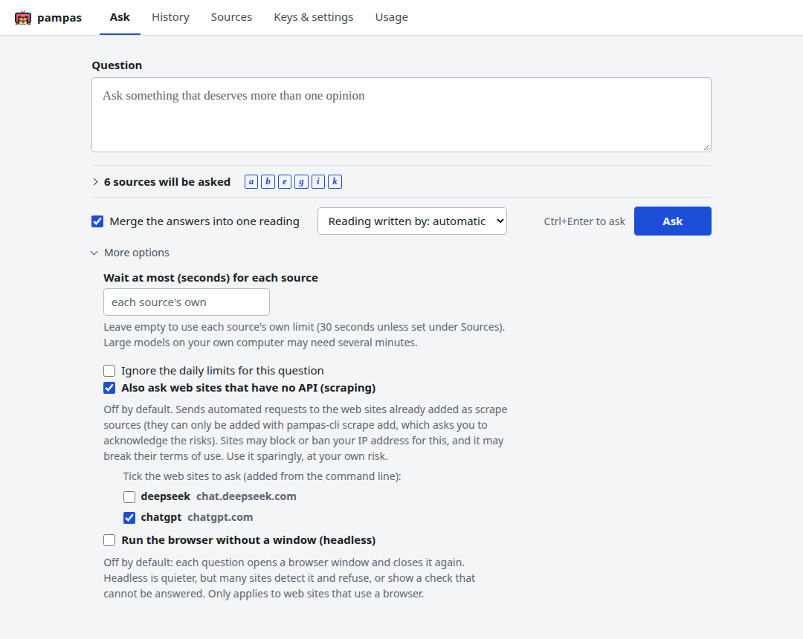
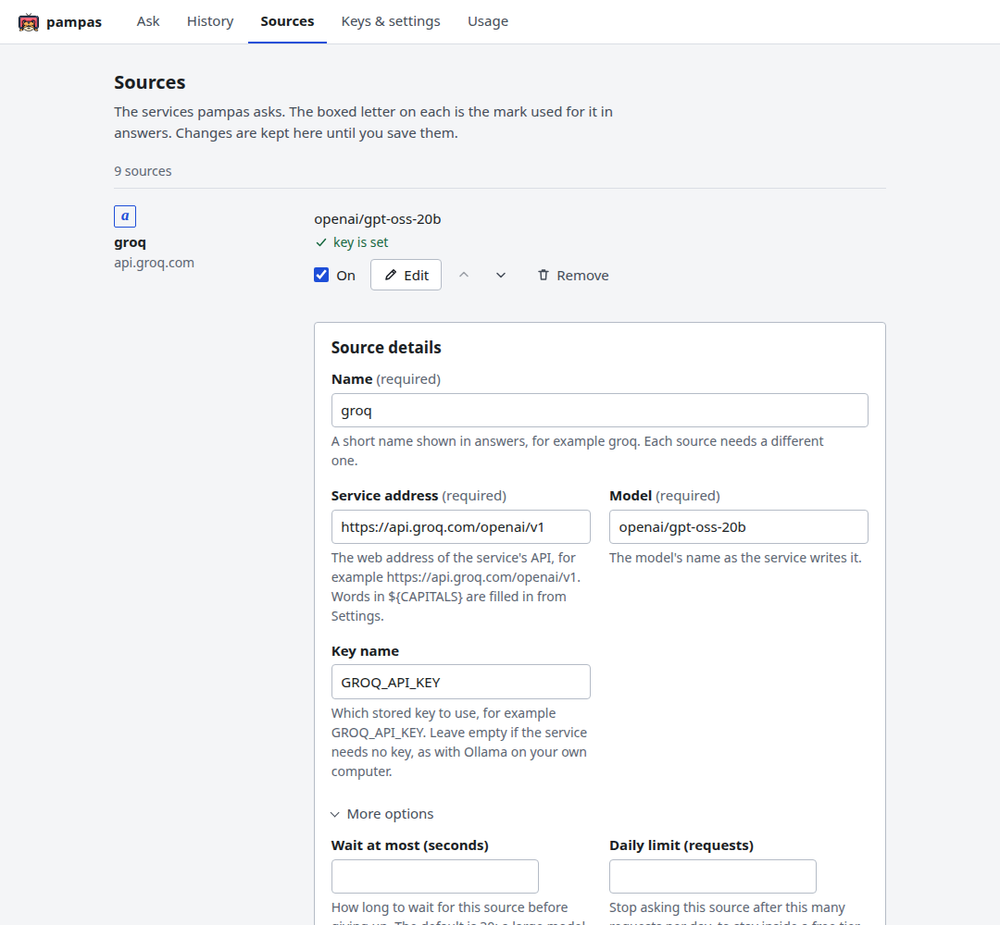
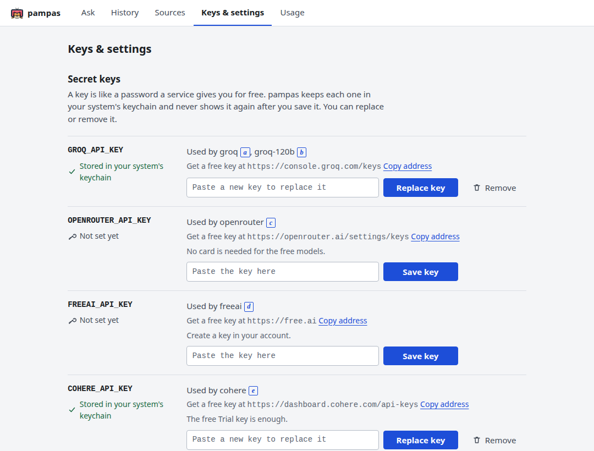
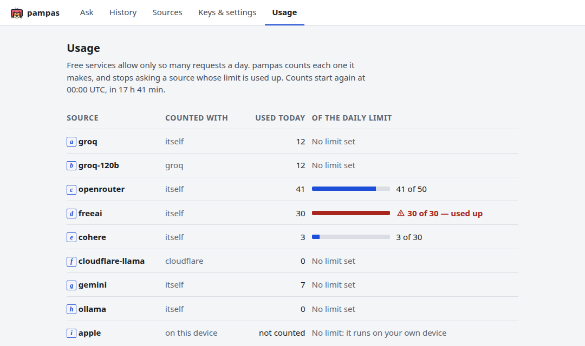

# pampas

Version: 0.9.1

**pampas** is short for Parallel AI Multi-provider Prompt Aggregator & Synthesizer: a command-line tool and desktop app that send one prompt to several free AI services in parallel and merge the results.

## Contents

- [Quick start](#quick-start)
- [Configuration](#configuration)
- [Providers](#providers)
- [Flags](#flags)
- [Output formats](#output-formats)
- [Merging answers](#merging-answers)
- [Usage limits](#usage-limits)
- [API keys](#api-keys)
- [Settings](#settings)
- [File locations](#file-locations)
- [Ollama](#ollama)
- [Cloudflare Workers AI](#cloudflare-workers-ai)
- [Apple Intelligence](#apple-intelligence)
- [Scraping web sites](#scraping-web-sites)
- [GUI (in development)](#gui-in-development)
- [Building installers](#building-installers)
- [Environment variables](#environment-variables)
- [Platform status](#platform-status)
- [Attribution](#attribution)

## Quick start

The command line is called `pampas-cli` and needs only Rust to build. From a checkout, `./pampas` is a wrapper that builds and runs it (`cargo run --` does the same); once built or installed, type `pampas-cli` instead of `./pampas` in every example below.

```
./pampas init                    # write the starter list of free services to your config
./pampas key types               # which keys that list uses
./pampas key set GROQ_API_KEY    # store a free key (typed at a hidden prompt)
./pampas "your prompt"
```

Get a key for each service you want (see [Getting API keys](#getting-api-keys)) and store it with `pampas-cli key set` or an environment variable (see [API keys](#api-keys)). A provider with no key is skipped with a warning, so you can start with one. Each provider's answer is printed under a `## name` heading; failures go to stderr. Add `--merge` for one consolidated answer. For the desktop app, run `./pampas --gui` (see [GUI](#gui-in-development)).

## Configuration

Providers are listed in `providers.json` in the config directory (see [File locations](#file-locations)), a JSON array. Any service with an OpenAI-compatible `/chat/completions` API works:

```json
[
  {
    "name": "groq",
    "base_url": "https://api.groq.com/openai/v1",
    "model": "<model id>",
    "api_key_env": "GROQ_API_KEY"
  }
]
```

| Field | Default | Meaning |
|---|---|---|
| `name` | required | The name shown in answers and given to `--enable`, `--disable` and `--synthesizer`. |
| `base_url` | required | The service's API address. It may contain `${NAME}` placeholders, filled from the environment variable `NAME`, else the stored setting `NAME` (see [Settings](#settings)); a provider whose placeholder is set in neither place is skipped with a warning. |
| `model` | required | The model's id as the service writes it. |
| `api_key_env` | none | The name of the key: an environment variable, or the keychain entry of that name (see [API keys](#api-keys)). Leave it out for a service that needs no key, such as Ollama. A provider whose named key is missing is skipped with a warning. |
| `chat_path` | `/chat/completions` | The path appended to `base_url` for chat requests, for services that use a different one, such as Free.ai's `/chat/`. |
| `fallback` | none | `"free_models"`: see below. |
| `timeout` | 30 | Seconds to wait for this provider; `--timeout` overrides it for a run (see [Flags](#flags)). |
| `synthesizer` | `false` | With `--merge`, the first running entry marked `true` writes the consolidated answer (see [Merging answers](#merging-answers)). |
| `daily_limit` | none | The most requests to make per UTC day, after which the provider is skipped (see [Usage limits](#usage-limits)). |
| `usage_group` | the entry's name | The name requests are counted under; entries that share one account's quota should share a group. |
| `enabled` | `true` | `false` leaves the provider out of runs unless `--enable <name>` is given. |
| `kind` | `openai` | `apple_fm` for Apple's on-device model, which takes only `name`, `command`, `enabled` and `synthesizer` (see [Apple Intelligence](#apple-intelligence)); `scrape` for a web site with no API (see [Scraping web sites](#scraping-web-sites)). |

`fallback: "free_models"` makes a provider whose `model` fails (an HTTP error such as `429` or `404`; a timeout does not trigger it) list the service's `/models` and try up to 3 free text models in listed order (a model counts as free when its prompt and completion prices are both `0` and its id ends in `:free`; safety classifiers and non-text models are skipped). When a fallback model answers, a notice naming it goes to stderr. The whole attempt, fallbacks included, shares the timeout, so raise it (for example `--timeout 60`) for providers with a fallback. It needs a service that lists pricing in `/models`, as OpenRouter does; the example `openrouter` entry uses it.

## Providers

Status as found while testing on 2026-10-22, each model with a real key. Free tiers change often; the limits, with how far each is confirmed, are in [Free-tier limits](#free-tier-limits) below.

### Working free services

| Service | Entries in `examples/providers.json` | Models tested and working | Notes |
|---|---|---|---|
| **Groq** | `groq`, `groq-120b` | `openai/gpt-oss-20b`, `openai/gpt-oss-120b` | Fast. The two entries share a `groq` usage group. The nearest free route to OpenAI models. |
| **OpenRouter** | `openrouter` | `minimax/minimax-m3.1-flash:free` | The set of free models changes: of 18 listed free models, 11 answered, `google/gemma-4-31b-it:free` returned `429` (rate-limited upstream), `openai/gpt-oss-120b:free` was removed (`404`), and two returned `403`. The entry has `"fallback": "free_models"`, which tries other free models when its own fails. |
| **Free.ai** | `freeai` | `qwen7b` | Chat endpoint is `/chat/` (`chat_path`). Once returned `503` "chat queue is currently full". |
| **NVIDIA** | `nvidia-deepseek`, `nvidia-glm`, `nvidia-nemotron` | `deepseek-ai/deepseek-v4.1-flash`, `z-ai/glm-5.3-flash`, `nvidia/nemotron-3-ultra-550b-a55b` | 83 models listed. `openai/gpt-oss-20b` and `google/gemma-4-31b-it` timed out after 90 s, `moonshotai/kimi-k2.6` returned `404` for the account. Entries share an `nvidia` group. |
| **Cloudflare Workers AI** | `cloudflare-gpt-oss`, `cloudflare-llama`, `cloudflare-gemma` | `@cf/openai/gpt-oss-120b`, `@cf/meta/llama-3.3-70b-instruct-fp8-fast`, `@cf/google/gemma-4-26b-a4b-it` | Set `CLOUDFLARE_ACCOUNT_ID`; each `base_url` reads it. `@cf/zai-org/glm-5.3-flash` returns `403`: not on the free plan. Entries share a `cloudflare` group. |
| **Cohere** (trial key) | `cohere`, `cohere-r-plus` | `command-a-plus-05-2026`, `command-r-plus-08-2024` (also `command-a-03-2025`, `command-r7b-12-2024`) | OpenAI-compatible endpoint `https://api.cohere.ai/compatibility/v1`. Entries share a `cohere` group. |
| **Google Gemini** | `gemini`, `gemini-lite` | `gemini-flash-latest`, `gemini-flash-lite-latest` | The `-latest` aliases keep working as models change; `gemini-2.5-flash` returned `404` (retired for new keys) and `gemma-4-31b-it` a `500`. The key must come from a new AI Studio project, or it can return `403 PERMISSION_DENIED`. Google may use free-tier prompts to improve its products. Entries share a `gemini` group. |
| **Ollama** (local or remote) | `ollama`, `ollama-remote` | `qwen2.5:3b` (local), `gemma4:12b` (remote) | No key. Both entries are `enabled: false` in the example, so use `--enable ollama`. See [Ollama](#ollama). |
| **Apple Intelligence** | `apple` | Apple's on-device model | Needs macOS 26 or later on Apple silicon with Apple Intelligence on, and the Swift helper (see [Apple Intelligence](#apple-intelligence)). Skipped if unavailable. |

### Free-tier limits

What was found when these were checked on 2026-10-23, and how far to trust each figure. Limits change and often differ per account, so the service's own page for your account is the final word. The last column shows the `daily_limit` in `examples/providers.json`; it is only set where the limit is confirmed and can be expressed as requests.

| Service | Limit | Reliability | Where to see yours | `daily_limit` set |
|---|---|---|---|---|
| Cohere (trial key) | 1,000 calls a month; 20 requests a minute per Chat model; non-commercial use only | Confirmed: [Cohere rate limits](https://docs.cohere.com/docs/rate-limits) | https://dashboard.cohere.com | 30 |
| Cloudflare Workers AI | 10,000 Neurons a day; 300 requests a minute for text models | Confirmed: [pricing](https://developers.cloudflare.com/workers-ai/platform/pricing/), [limits](https://developers.cloudflare.com/workers-ai/platform/limits/) | The Workers AI page in the dashboard | none |
| Groq | `gpt-oss` models: 30 requests a minute, 1,000 a day, 8,000 tokens a minute, 200,000 a day | The docs table is for the Developer plan; third-party pages report the same for free accounts | The limits page in the [Groq console](https://console.groq.com/docs/rate-limits) | none |
| NVIDIA | About 40 requests a minute; meant for development, not production | User reports on the [developer forum](https://forums.developer.nvidia.com/t/request-for-nvidia-nim-api-rate-limit-increase-40-200-rpm/375340); no official figure found, no daily cap reported | The top right of https://build.nvidia.com | none |
| Google Gemini | Not published | Google says limits "can be viewed in Google AI Studio" and vary by project and model; third-party reports conflict (about 1,500 requests a day down to about 100), so none is used | [Rate limits in AI Studio](https://ai.google.dev/gemini-api/docs/rate-limits) | none |
| OpenRouter | 50 requests a day and 20 a minute on `:free` models without credit | OpenRouter's own figure, as tested | Your OpenRouter account | 50 |
| Free.ai | 30,000 tokens a day and 1,000 requests a month | As reported by the service when tested | Your Free.ai account | 30 |
| Ollama | None; your own hardware | n/a | n/a | none |
| Apple Intelligence | None; on-device | n/a | n/a | not counted |

**How pampas uses them.** It counts requests per UTC day and skips a provider at its `daily_limit` (see [Usage limits](#usage-limits)). It cannot count monthly caps (Cohere, Free.ai), so those use a daily figure of about a thirtieth of the month: 30 a day. It cannot count Cloudflare's Neurons, which depend on tokens rather than requests: a 100-token prompt with a 300-token answer costs about 24 Neurons on `gpt-oss-120b` (31,818 per million input tokens, 68,182 per million output), so roughly 400 such requests a day. For Groq, NVIDIA and Gemini no `daily_limit` is set until you have confirmed your own limits; to set one, add `"daily_limit": N` to the entry (and share a `usage_group` between entries that share an account).

### Getting API keys

Store each key with `pampas-cli key set <NAME>` or export it as an environment variable; see [API keys](#api-keys). `pampas-cli key types` lists the names your config uses.

| Service | Environment variable | Where to get it |
|---|---|---|
| Groq | `GROQ_API_KEY` | https://console.groq.com/keys: sign in, **Create API Key**. |
| OpenRouter | `OPENROUTER_API_KEY` | https://openrouter.ai/settings/keys: sign in, **Create Key**. No card needed for `:free` models. |
| Free.ai | `FREEAI_API_KEY` | Sign up at https://free.ai and create a key in your account (the exact page was not recorded; keys start `sk-free-`). |
| NVIDIA | `NVIDIA_API_KEY` | https://build.nvidia.com: sign in with an email, open any model and choose **Get API Key** (keys start `nvapi-`). |
| Cloudflare | `CLOUDFLARE_API_KEY` | https://dash.cloudflare.com/profile/api-tokens: **Create Token** with the **Workers AI** permission. It also needs your account id: see [Cloudflare Workers AI](#cloudflare-workers-ai). |
| Cohere | `COHERE_API_KEY` | https://dashboard.cohere.com/api-keys: the default **Trial** key is enough. |
| Google Gemini | `GEMINI_API_KEY` | https://aistudio.google.com/apikey: **Create API key**, choosing **Create API key in new project**. Do not enable billing on the project. |
| Ollama | none | No key; see [Ollama](#ollama). |
| Apple Intelligence | none | No key; build the helper as described under [Apple Intelligence](#apple-intelligence). |

### Tried and not usable for free

| Service | Why not |
|---|---|
| **OpenAI API** | No free tier. ChatGPT's free tier is the web app only, with no API; scraping it breaks OpenAI's terms and is fragile. Open-weight `gpt-oss` models are available free through Groq, NVIDIA (`gpt-oss-20b`, slow) and Cloudflare instead. |
| **xAI (Grok)** | No free tier. |
| **Mistral** | No free tier. |
| **DeepSeek API** | Pay-as-you-go; third-party sources mention a one-off trial credit that expires, unconfirmed. DeepSeek V4.1 Flash is free through NVIDIA (`nvidia-deepseek`). |
| **Cerebras** | The no-card free tier ended; new accounts get a $5 trial credit that expires after 30 days and needs a payment method (reported). |
| **SambaNova** | A key with a zero balance returned `402 PAYMENT_METHOD_REQUIRED` for every model; a payment method is required. |
| **Hugging Face Inference Providers** | A free account had no credits (`402`, "subscribe to PRO to get monthly included credits"). |
| **GitHub Models** | One source says it was retired on 30 July 2026; not verified here. |

## Flags

### Options

- `<prompt>`: the prompt sent to every provider.
- `--timeout <secs>`: per-provider timeout in seconds. Without it a provider gets its entry's `timeout`, else 30. With it, every provider gets this value for the run, so it overrides entries; the `--merge` call uses the synthesizer's timeout the same way.
- `--enable <name>`: run a provider whose config entry has `"enabled": false`. Repeatable, or comma-separated (`--enable a,b`).
- `--disable <name>`: leave a provider out of this run. Repeatable, or comma-separated. A name that matches no configured provider, or is both enabled and disabled, is an error.
- `--only <name>`: ask only this provider, even if its entry has `"enabled": false`, and leave every other one out (so `pampas-cli --scrape --only deepseek "..."`). Cannot be combined with `--enable` or `--disable`; an unknown name is an error. Scrape sources still need `--scrape`.
- `--merge`: consolidate the answers into one, see [Merging answers](#merging-answers).
- `--synthesizer <name>`: with `--merge`, the provider that writes the consolidated answer.
- `--show-answers`: with `--merge`, also print each provider's own answer after the consolidated one.
- `-f, --format <text|markdown|md|json>`: output format, see [Output formats](#output-formats) (default `markdown`).
- `-o, --output <path>`: write the result to this file instead of stdout, overwriting it. A `wrote <path>` note goes to stderr. If the file cannot be written, the result is printed to stdout instead and `pampas` exits with an error.
- `--headless`: run browser scrape sources without a window for this run, whatever their entries say (needs `--scrape`; many sites refuse a browser with no window, so the default is a visible window). Sources that are not browser sources are unaffected.
- `--ignore-limits`: ignore every `daily_limit` for this run; requests are still counted.
- `scrape add|remove|list|login` (a command, see [Scraping web sites](#scraping-web-sites)) adds, removes, lists or logs in to scrape sources.
- `--scrape`: also ask the `"kind": "scrape"` entries, web sites that have no API (see [Scraping web sites](#scraping-web-sites)). Off by default; prints a warning that your IP address can be blocked or banned. Without it those entries are skipped with a warning.
- `--usage-file <path>`: where request counts are kept (default `usage.json` in the state directory, see [File locations](#file-locations)). Also accepted by `pampas-cli usage`.
- `--config <path>`: providers config file (default `providers.json` in the config directory, see [File locations](#file-locations)). Also accepted by `pampas-cli key list`.

Options such as `--config` and `--usage-file` can come before or after a subcommand (`pampas-cli --config <path> key list` and `pampas-cli key list --config <path>` are the same). Options that only apply to a prompt run, such as `--merge`, are ignored with a subcommand. A prompt that is literally `key`, `usage`, `init` or `setting` must be written `pampas-cli -- key`.

### Commands

- `pampas-cli init`: write the bundled example config to the config path (`--config`, default in the config directory); it never overwrites an existing file. Run it first, then edit the file. If you skip it, `pampas-cli usage`, `pampas-cli key list` and a prompt run offer to do it on a terminal when the default config is missing (`Create it from the bundled example? [y/N]`); with piped input, or with a `--config` path, they just fail with an error pointing at `pampas-cli init`.
- `pampas-cli key set|delete|list|types`: manage stored keys; see [API keys](#api-keys).
- `pampas-cli setting set|delete|list`: manage the values behind `${NAME}` placeholders in `base_url`; see [Settings](#settings).
- `pampas-cli usage`: today's request counts; see [Usage limits](#usage-limits).
- `pampas-cli migrate`: on macOS, move your files from the old locations to the current ones (see [File locations](#file-locations)); elsewhere it reports nothing to migrate.

`key list`, `key types`, `setting list` and `usage` print an aligned table with a header row on a terminal, and bare tab-separated lines (no header) when piped, so scripts can parse them.

## Output formats

`--format` chooses how the result is written, to stdout or to `--output <path>`. Failures and warnings always go to stderr, whatever the format.

- `markdown` (alias `md`, the default): each answer under a `## name` heading.
- `text`: each answer under a `name:` line, with no markup.
- `json`: one pretty-printed JSON object:

```json
{
  "prompt": "the prompt",
  "answers": [
    { "provider": "groq", "ok": true, "answer": "..." },
    { "provider": "openrouter", "ok": false, "error": "HTTP 429 ..." }
  ],
  "merged": { "provider": "groq-120b", "answer": "..." },
  "merge_error": null
}
```

`answers` lists every provider that ran, in config order, failures included (`ok` false, with `error`). `merged` is `null` unless `--merge` produced a consolidated answer; `merge_error` is a string when `--merge` was given and failed (then `merged` is `null`), else `null`. Key order is alphabetical. `json` always includes the separate answers, so `--show-answers` has no effect on it.

With `--merge`, markdown and text show the merged answer first (as `merged (by <name>)`) and the separate answers only with `--show-answers`, or instead of it if merging failed.

## Merging answers

By default each provider's answer is printed under its name. With `--merge`, pampas collects the answers and asks one provider, the synthesizer, to write a single answer: points all the answers agree on stated once, disagreements called out with the models that differ, and nothing added that no answer said. How the merged answer is printed is described under [Output formats](#output-formats).

The synthesizer is `--synthesizer <name>` if given, else the first running entry with `"synthesizer": true`, else the first running provider. It must be a running provider (enabled, with a key, or with its Apple model available), and it also answers the prompt like the others.

Merging costs one extra request to the synthesizer, which matters on free tiers, and the `--timeout` applies to it again. If only one provider answered, that answer is printed as is. If no provider answered, `pampas` exits with an error. If the synthesizer fails, the separate answers are printed instead, with a warning on stderr. A synthesis is a model's reading of the other answers, so check disagreements against the separate answers (`--show-answers`) when it matters.

## Usage limits

Free tiers cap requests per day, and going over can get a key throttled or blocked. pampas therefore counts every request it makes to an OpenAI-compatible provider, per UTC day (the day most services reset on), in the file given by `--usage-file`. Apple Intelligence entries are local and not counted.

- **What counts:** each request to the chat endpoint, counted before it is sent, so a failed request (a `429`, say) still counts. A `fallback` model attempt and the `--merge` synthesis call each count as one request. Listing `/models` for a fallback does not.
- **Limits:** set `"daily_limit": N` on an entry. Once the count reaches `N` the provider is skipped with a warning at startup, and a request that would exceed it mid-run (a fallback, or the synthesis call) is refused rather than sent. At 80% of the limit each request prints a `used of limit` note on stderr. `--ignore-limits` turns this off for a run.
- **Sharing:** entries that draw on one account's quota can share a counter with the same `"usage_group"`. Each entry still checks the shared count against its own `daily_limit`. The example config groups the two Groq entries.
- **Viewing:** `pampas-cli usage` prints a table of each entry's name, usage group and `used/limit` (`-` if there is no limit). For example, after a few requests:

```
$ pampas-cli usage
PROVIDER            GROUP          USED/LIMIT
groq                groq           12/-
groq-120b           groq           12/-
openrouter          openrouter     41/50
freeai              freeai         3/30
cohere              cohere         0/30
gemini              gemini         7/-
ollama              ollama         0/-
apple               -              local, not counted
```

  The two Groq entries show the same count because they share a usage group. The list is shortened here; it has one row per config entry.
- **Limits of the counter:** it only knows the requests pampas made on this machine, so use from other tools or machines is not seen, and the file is not locked, so two `pampas` runs at the same moment can lose a count. Limits are daily; monthly caps are approximated (see [Free-tier limits](#free-tier-limits)). An unreadable counts file is moved to `usage.json.corrupt` with a warning and counting starts again from zero.

## API keys

Each provider's `api_key_env` is the name of its key. pampas looks for the key in this order:

1. The environment variable of that name (an empty value counts as unset).
2. The OS keychain: macOS Keychain, or the Secret Service on Linux (GNOME Keyring, KWallet, or anything else that implements it). Entries are stored under the service `pampas`, named by `api_key_env`. `secret-tool search service pampas` lists the stored keys on Linux.

Keys never go in the providers config file.

- `pampas-cli key set <NAME> [--stdin]`: store a key, e.g. `pampas-cli key set GROQ_API_KEY`. The key is typed at a hidden prompt, so it never appears on screen or in shell history. With `--stdin` the key is read from standard input instead, for scripts and password managers: `pass show groq | pampas-cli key set GROQ_API_KEY --stdin`, or `pampas-cli key set GROQ_API_KEY --stdin < keyfile`. There is deliberately no way to pass the key as an argument: it would sit in shell history, which a program cannot edit, and in `ps` output while the command runs. If you do type a key into the shell by mistake, delete the history line yourself (`history -d`/`fc`, or edit `~/.zsh_history`) and treat the key as exposed.

  ```
  $ pampas-cli key set GROQ_API_KEY
  GROQ_API_KEY:                      <- typed at a hidden prompt, nothing is echoed
  stored GROQ_API_KEY in the OS keychain

  $ pass show groq | pampas-cli key set GROQ_API_KEY --stdin
  stored GROQ_API_KEY in the OS keychain

  $ pampas-cli key set GROQ_API_KEY --stdin < ~/groq.key
  stored GROQ_API_KEY in the OS keychain
  ```

  Trailing whitespace and the final newline are trimmed, and empty input is an error (`no key entered`). Delete a key file once it is stored.
- `pampas-cli key delete <NAME>`: remove a stored key.
- `pampas-cli key types [--config <path>]`: a table (`KEY`, `PROVIDERS`) of the key names the config uses (the names to give `key set`), with the providers that use it, comma-separated. Providers with no key are left out. With no config file at the default path it lists the keys of the bundled example config instead and says so on stderr.
- `pampas-cli key list [--config <path>]`: a table (`PROVIDER`, `KEY`, `SOURCE`) with one row per configured provider: where its key comes from (`environment variable`, `OS keychain`, `missing`, `no key needed`, or `error: ...` if the keychain itself failed). Keys themselves are never printed.

  ```
  $ pampas-cli key list
  PROVIDER            KEY                 SOURCE
  groq                GROQ_API_KEY        environment variable
  openrouter          OPENROUTER_API_KEY  missing
  gemini              GEMINI_API_KEY      OS keychain
  ollama              -                   no key needed
  apple               -                   no key needed
  ```

  `missing` means neither the environment variable nor the keychain has the key: run `pampas-cli key set <KEY>`. The list is shortened here; it has one row per config entry.

On a machine with no Secret Service (a headless Linux server, a container, CI), the keychain is unavailable: use environment variables there. A missing keychain only matters for providers whose environment variable is unset.

## Settings

Some values are not secrets but still differ per user: a Cloudflare account id, the address of a remote Ollama server. The example config refers to them as `${NAME}` placeholders in `base_url`, so the config itself holds nothing personal and can be shared. Each placeholder is filled from, in order:

1. The environment variable `NAME` (an empty value counts as unset).
2. The stored setting `NAME`, in `settings.json`, beside the providers config (see [File locations](#file-locations)).

A provider whose placeholder is set in neither place is skipped with a message naming it, like a missing key.

- `pampas-cli setting set <NAME> [VALUE]`: store a value, e.g. `pampas-cli setting set CLOUDFLARE_ACCOUNT_ID 0123456789abcdef0123456789abcdef`. Leave the value out and pampas asks for it at a prompt (`CLOUDFLARE_ACCOUNT_ID: `); the input is shown, since settings are not secrets. With no value and no terminal (piped input) it is an error. It refuses names ending in `_KEY`, `_TOKEN`, `_SECRET` or `_PASSWORD`: the file is plain text, so keep secrets in the keychain with `pampas-cli key set`.
- `pampas-cli setting delete <NAME>`: remove a stored value.
- `pampas-cli setting list [--config <path>]`: a table of every placeholder the config uses plus anything stored, with its value and where it comes from.

```
$ pampas-cli setting list
NAME                   VALUE                             SOURCE
CLOUDFLARE_ACCOUNT_ID  0123456789abcdef0123456789abcdef  settings file
OLLAMA_REMOTE_HOST     -                                 not set
```

Values are shown in full because they are not secret. `setting list` and the other `setting` commands use the `settings.json` beside the `--config` file you pass, so a scratch config gets its own settings.

## File locations

pampas keeps four files: `providers.json` (the providers), `settings.json` (the `${NAME}` values), `usage.json` (request counts) and `history.json` (the app's saved sessions: your questions and the answers, in plain text, newest 200; delete a session in the History tab, or delete the file). The CLI and the GUI use the same locations; only the GUI writes `history.json` so far.

| Platform | Config directory (`providers.json`, `settings.json`) | State directory (`usage.json`, `history.json`) |
|---|---|---|
| Linux | `$XDG_CONFIG_HOME/pampas`, else `~/.config/pampas` | `$XDG_STATE_HOME/pampas`, else `~/.local/state/pampas` |
| macOS | `~/Library/Application Support/pampas` | `~/Library/Application Support/pampas` |
| Windows | `%APPDATA%\pampas` | `%LOCALAPPDATA%\pampas` |

On Linux and macOS an `XDG_*` variable that is set overrides the default, which is handy for a scratch run. `--config` and `--usage-file` override everything, and `settings.json` always sits beside the providers config.

**Upgrading on macOS.** Versions before 0.4.3 used the Linux locations (`~/.config/pampas` and `~/.local/state/pampas`) on macOS. Those files are still used when nothing exists at the new location, with a note on stderr, until you run `pampas-cli migrate`, which moves them (it never overwrites a file that already exists at the new location).

## Ollama

[Ollama](https://ollama.com) runs models on your own machine or on one you control. It serves an OpenAI-compatible API under `/v1`, so pampas needs only a config entry, with no key and no code. Leave `api_key_env` out and no `Authorization` header is sent.

### Local

1. Install Ollama and pull a model: `ollama pull qwen2.5:7b`. `ollama list` shows what you have.
2. Add an entry:

```json
{ "name": "ollama", "base_url": "http://localhost:11434/v1", "model": "qwen2.5:7b" }
```

3. Run it: `pampas-cli "your prompt"`. If the entry has `"enabled": false`, add `--enable ollama`.

`model` must be exactly a name from `ollama list`, tag included (`qwen3:14b`, not `qwen3`).

### Remote

Put the other machine's address in the `base_url`, here through an environment variable so the config holds no addresses (`export OLLAMA_REMOTE_HOST=<address>`):

```json
{ "name": "ollama-remote", "base_url": "http://${OLLAMA_REMOTE_HOST}:11434/v1", "model": "gemma4:12b" }
```

By default Ollama listens only on `127.0.0.1`, so on the server start it with `OLLAMA_HOST=0.0.0.0 ollama serve`. If it runs as a systemd service, run `sudo systemctl edit ollama`, add `Environment="OLLAMA_HOST=0.0.0.0"` under `[Service]`, then `sudo systemctl restart ollama`. Open port 11434 in any firewall. Ollama has no authentication of its own, so expose it only on a trusted network. If a reverse proxy in front of it wants a bearer token, set `api_key_env` to the variable that holds it (see [API keys](#api-keys)).

Check that the server is reachable and see its models with `curl http://$OLLAMA_REMOTE_HOST:11434/api/tags`. A `Connection refused` means the server is not running or not listening beyond localhost.

### Notes

- Local models can be slow, especially on the first request while the model loads into memory. Give the entry a `"timeout"` in seconds (the example `ollama` entries use `180`) instead of raising `--timeout` for every provider; a large model may need more. `--timeout` still overrides it for one run.
- Several Ollama entries on one machine run at the same time and compete for it. A large model alongside others can be slow or run out of memory, so enable only the ones you need.
- `fallback: "free_models"` does not apply: Ollama's model list has no pricing.

## Cloudflare Workers AI

The three `cloudflare-*` example entries need two things from your Cloudflare account: an API token (secret) and your account id (not secret, but part of the endpoint URL).

1. **Account id.** In the Cloudflare dashboard (`dash.cloudflare.com`) it is in any of these places; the layout changes now and then, so treat the exact labels as approximate:
   - the address bar after you log in: `https://dash.cloudflare.com/<32-character id>/home`;
   - **Account Home**, in the three-dot menu next to the account name: **Copy account ID**;
   - **Compute** > **Workers & Pages**, the overview page, in the right-hand sidebar;
   - **AI** > **Workers AI**, which shows the account id and a ready-made API URL (useful to confirm you picked the account that has Workers AI if you have several).
2. **API token.** Create one at https://dash.cloudflare.com/profile/api-tokens (**Create Token**) with the **Workers AI** permission.
3. **Store them.** The token is a secret, so it goes in the keychain; the account id is a setting:

```
pampas-cli key set CLOUDFLARE_API_KEY
pampas-cli setting set CLOUDFLARE_ACCOUNT_ID      # asks for the id; or add it: ... CLOUDFLARE_ACCOUNT_ID <id>
```

   Either can be an environment variable instead (`CLOUDFLARE_API_KEY`, `CLOUDFLARE_ACCOUNT_ID`); the environment wins. The entries' `base_url` is `https://api.cloudflare.com/client/v4/accounts/${CLOUDFLARE_ACCOUNT_ID}/ai/v1`, so they are skipped with a message until the account id is set (see [Settings](#settings)).
4. **Check.** `pampas-cli key list` should show `CLOUDFLARE_API_KEY` found, and `pampas-cli setting list` should show `CLOUDFLARE_ACCOUNT_ID` set.

Notes: the free plan is limited in Neurons per day, not requests; see [Free-tier limits](#free-tier-limits). The three entries share a `cloudflare` usage group, and `@cf/zai-org/glm-5.3-flash` returns `403` on the free plan. The account-id locations above come from memory of the dashboard, not from a fresh look.

## Apple Intelligence

On a Mac with Apple Intelligence (macOS 26 or later, Apple silicon), pampas can also ask Apple's on-device model. It is free, offline and needs no key. Apple only exposes it to Swift, so a small helper, `helpers/apple-fm.swift`, bridges it. Build it once and put it on your `PATH`:

```
swiftc -O helpers/apple-fm.swift -o ~/.local/bin/pampas-apple-fm
```

Then add an entry with `"kind": "apple_fm"` (the example config has one):

```json
{ "name": "apple", "kind": "apple_fm" }
```

`command` is optional (default `pampas-apple-fm`, looked up on `PATH`; a value with a slash is used as a path). Entries without `kind` are OpenAI-compatible as before. At startup `pampas` runs `pampas-apple-fm --check`; if the helper is missing or the model is unavailable (Apple Intelligence off, unsupported Mac, model still downloading), the entry is skipped with a warning and the other providers still run, so the same config works on any machine. `pampas-cli key list` shows `no key needed` for these entries.

## Scraping web sites

For a web site that has no API, an entry with `"kind": "scrape"` sends the prompt in an ordinary HTTP request and reads the answer out of the page or out of a JSON reply. Scrape sources can only be **added from the command line** (`pampas-cli scrape add`), which shows the risks below and needs you to acknowledge them: type `I understand` at a terminal, or pass `--acknowledge` (the risks are still printed, followed by a line saying you acknowledged them; no terminal is needed, so a script can add a source, and the flag is a statement that you have read them). Once added they appear in the app's Sources tab, where you can switch them on or off and change their timeout and daily limit, but not add them or change their address or request (the app refuses a saved list that does). They are off unless you ask for it, with `--scrape` on the command line or **Also ask web sites that have no API (scraping)** under *More options* on the Ask tab.

**Risks.** Automated requests to a web site can get your IP address blocked or banned (by that site, and sometimes by the network in front of it), and may break the site's terms of use. Pampas sends one request per question, identifies itself as `pampas` (set `user_agent` to change that), and does not try to hide or get around blocks, logins or captchas. Use `daily_limit` to keep the count low, and stop if a site starts answering `403` or `429`. You are responsible for the sites you add; none are built in, and the bundled example config has none.

```
pampas-cli scrape add some-site --url 'https://example.com/search?q={prompt}' --selector 'main p' --daily-limit 20
pampas-cli scrape list
pampas-cli scrape remove some-site
```

`scrape remove <name>` takes a scrape source out of the providers config (the previous file is kept as `providers.json.bak`); it refuses any other kind of source, and needs no acknowledgement. A browser source's login stays in its profile folder under the state directory, so adding it again does not need another login.

`scrape add` options: `--url`, `--selector` or `--json-pointer`, `--body` (makes it a POST), `--body-format form|json`, `--header 'Name: value'` (repeatable), `--user-agent`, `--daily-limit`, `--timeout`. It writes this entry (the previous file is kept as `providers.json.bak`):

```json
{
  "name": "some-site",
  "kind": "scrape",
  "url": "https://example.com/search?q={prompt}",
  "selector": "main p",
  "daily_limit": 20
}
```

| Field | Default | Meaning |
|---|---|---|
| `name`, `enabled`, `synthesizer`, `daily_limit`, `timeout`, `usage_group` | | As for other providers. |
| `url` | required | Address to request. `{prompt}` is replaced by the prompt, percent-encoded. |
| `method` | `get` | `get` or `post`. |
| `body` | none | Request body for `post` (required then). `{prompt}` is replaced by the prompt. |
| `body_format` | `form` | `form` (`application/x-www-form-urlencoded`, prompt percent-encoded) or `json` (prompt escaped inside a JSON string). |
| `headers` | none | Extra request headers, for example `Accept-Language`. `{prompt}` is not replaced here. |
| `user_agent` | `pampas` | The `User-Agent` header. |
| `selector` | | CSS selector for the elements whose text is the answer (HTML reply). One paragraph per match. |
| `json_pointer` | | JSON pointer such as `/data/0/text` to the answer (JSON reply). Give `selector` or `json_pointer`, not both. |

### Pages that need JavaScript or a login (browser sources)

A source with `"render": "browser"` drives a real Chrome or Chromium instead of sending one request, for a chat page that only works in a browser and behind a login. For each question pampas opens the browser on a profile folder of its own for that source (in the state directory under `browser/`), loads `url`, types the prompt into the input box, sends it, waits until the answer has stopped changing, reads it and closes the browser. It does not hide that the browser is automated, and does not get around logins, captchas or blocks. It also puts the **account** you log in with at risk of being limited or suspended, not just your IP address; the `scrape add` prompt says so too.

Status of the built-in sites (`pampas-cli scrape add <name>`), as tried on Linux with Google Chrome on 2026-10-23. The sites change their pages without notice, so a setup that worked can stop working.

| Name | Site | Account | Status |
|---|---|---|---|
| `deepseek` | DeepSeek chat | DeepSeek | Works end to end. The stop button was not seen mid-answer, so there is no busy marker; answers that used web search contain stray citation numbers. |
| `chatgpt` | ChatGPT | OpenAI | Works end to end. The "still writing" marker was not seen mid-answer. |
| `copilot` | Microsoft 365 Copilot chat | Microsoft 365 | Works end to end (Enter does not send there, so the Send button is clicked). |
| `duckduckgo` | DuckDuckGo AI chat (duck.ai) | none | Works end to end. The stop-button marker was not seen mid-answer. |
| `deepai` | DeepAI chat | none | Works end to end (2026-10-27, signed out). The stop button was seen while the answer was written. |
| `perplexity` | Perplexity | none | Works end to end (2026-10-27, signed out). The answer ends with a citation label. |\n| `qwen` | Qwen Chat | Qwen (free) | Works end to end (2026-10-27, logged in to a free account); signed-out use was not checked. |
| `zai` | Z.ai chat (GLM) | Z.ai (free) | Works end to end (2026-10-27, logged in to a free account). The answer starts with a "Thought Process" line; no busy marker. |
| `kimi` | Kimi chat (kimi.ai) | Kimi (free) | Works end to end (2026-10-27, logged in to a free account). |
| `mistral` | Mistral chat (Vibe Work) | Mistral (free) | Works end to end (2026-10-27, logged in to a free account). |
| `google-ai-mode` | Google AI Mode | optional | Works end to end, but the answer includes citation labels, follow-up suggestions and a footer. |
| `bing` | Bing AI Mode (Copilot Search) | optional | Works end to end (the answer is read from an iframe). |

Example, DeepSeek's chat. It is built in, so the name alone is enough:

```
pampas-cli scrape add deepseek
pampas-cli --scrape --only deepseek "your question"
```

1. `scrape add deepseek` uses the built-in setup (below), shows the risks, and waits for you to type `I understand` (or pass `--acknowledge` to skip the typing). The rest of its options still work if you want to change a part of it (for example `--daily-limit 50`).
2. It then tells you that you need to log in once and opens an ordinary Chrome window on the source's own profile (not your everyday one, so you log in once more there). Log in until you see the chat, then **close the window** (on a Mac, quit the browser with Cmd+Q: closing the last window leaves Chrome running, and pampas waits for it to exit); two browsers cannot share a profile. The window has no automation switched on, because sign-in pages such as Google's refuse a browser that does. If that profile was used before, it skips the window and says so; run `pampas-cli scrape login deepseek` any time to log in again.
3. `--only deepseek` asks just that source (see [Flags](#flags)); drop it to ask DeepSeek alongside the other providers.

The built-in setup is the same as typing it out (selectors checked against the logged-in page on 2026-10-23; the site can change them at any time):

```
pampas-cli scrape add deepseek --url https://chat.deepseek.com/ --browser \
  --input-selector 'textarea[placeholder="Message DeepSeek"]' \
  --selector '.ds-markdown.ds-assistant-message-main-content' \
  --settle-secs 6 --daily-limit 20
```

Any option you give wins over the built-in value. Giving `--url` turns the built-in setup off, since you are then describing a different address. The built-in sites are `deepseek`, `chatgpt`, `copilot`, `duckduckgo`, `deepai`, `perplexity`, `qwen`, `zai`, `kimi`, `mistral`, `google-ai-mode` and `bing`; any other name needs `--url`.

Bing's AI Mode (Copilot Search) is built in as `bing` (`pampas-cli scrape add bing`, then `pampas-cli --scrape --only bing "your question"`). Typed out:

```
pampas-cli scrape add bing --url https://www.bing.com/copilotsearch --browser \
  --input-selector 'textarea[id^="b_copilot_composer"]' \
  --answer-frame '.frame_cont iframe' --selector '.gs_temp_ra' \
  --settle-secs 5 --daily-limit 20
```

Bing draws the answer inside an iframe of the page (a `bing.com/search` page), so this setup uses `--answer-frame`; `.gs_temp_ra` is the answer's lead sentence and paragraph without the source cards beside it. The input box's `id` is matched by its start because its placeholder changes from "Ask anything" to "Ask a follow up" after the first question. Checked on one answer on 2026-10-23; the stop-button marker, a second question in a chat and a signed-out browser were not. Bing may show a verification page for automated use, which pampas will not solve; if you sign in, the question is recorded in that Microsoft account's activity.

Google's AI Mode is built in as `google-ai-mode` (`pampas-cli scrape add google-ai-mode`, then `pampas-cli --scrape --only google-ai-mode "your question"`). Typed out:

```
pampas-cli scrape add google-ai-mode --url 'https://www.google.com/search?udm=50' --browser \
  --input-selector 'textarea[aria-label="Ask anything"]' \
  --selector '[data-container-id="main-col"]' \
  --busy-selector 'button[aria-label="Stop"]' \
  --settle-secs 5 --daily-limit 20
```

The answer selector was checked on a shared AI Mode page (Google's class names are scrambled, so it uses the `data-container-id="main-col"` attribute, which holds the answer without the "You said" line or the sources column); the live page, the stop button while an answer is being written, and a signed-out browser were **not** checked, so this is the least tested of the built-in sites. The input box has a hidden twin, and the first match (the visible one) is used. The login window may show a consent page or a sign-in prompt, and AI Mode may not be offered to a signed-out browser in your region; close the window once the "Ask anything" box is there. **Extra risk:** Google may show an "unusual traffic" page or a CAPTCHA, which pampas will not solve and which looks to pampas like a missing input box; it may block your IP address from Google Search for a while; and it may flag the account if you sign in. Its terms prohibit automated queries.

DuckDuckGo's AI chat is built in as `duckduckgo` (`pampas-cli scrape add duckduckgo`, then `pampas-cli --scrape --only duckduckgo "your question"`). It needs no account. It uses `https://duck.ai/chat` directly, because the `duckduckgo.com/#chat` page moves to that address when a question is sent. Typed out:

```
pampas-cli scrape add duckduckgo --url https://duck.ai/chat --browser \
  --input-selector 'textarea[name="user-prompt"]' \
  --selector '[id*="-assistant-message-"] .space-y-4' \
  --busy-selector 'button[aria-label="Stop generating"]:not([disabled])' \
  --settle-secs 4 --daily-limit 20
```

The window that opens after `scrape add` is for one step: the first time, DuckDuckGo asks you to click **Continue** to accept its terms of service; click it and close the window (the setting is kept in the pampas profile, which is separate from your own browser). Selectors checked on 2026-10-23; the answer selector skips the "said GPT-… · 1s" header and "2nd opinion" button that the answer's container also holds, and the busy marker (the stop button, which is on the page but disabled when idle) was not seen while an answer was being written. DuckDuckGo limits requests per address and may ask for a check if it sees automated use.

DeepAI's chat is built in as `deepai` (`pampas-cli scrape add deepai`, then `pampas-cli --scrape --only deepai "your question"`). It needs no account. It works end to end through pampas (2026-10-27, signed out). The selectors were checked on the live page: Enter sends, the stop button was seen while the answer was written, and each answer matches twice because the page nests one `.markdownContainer` inside another (pampas reads the last match, so this is harmless). Typed out:

```
pampas-cli scrape add deepai --url https://deepai.org/chat --browser \
  --input-selector 'textarea#persistentChatbox' \
  --submit-selector '#chatSubmitButton' \
  --selector '.outputBox .markdownContainer' \
  --busy-selector '#chatStopButton[style*="display: block"]' \
  --settle-secs 5 --daily-limit 20
```

The window that opens after `scrape add` needs no login: make sure the "Message AI Chat..." box is there, then close it. DeepAI limits free use, some models need DeepAI Pro, and it may ask for a check or limit your address if it sees automated use.

Perplexity is built in as `perplexity` (`pampas-cli scrape add perplexity`, then `pampas-cli --scrape --only perplexity "your question"`). It needs no account. Selectors were checked on the live page and the source was run end to end through pampas on 2026-10-27, signed out. Typed out:

```
pampas-cli scrape add perplexity --url https://www.perplexity.ai/ --browser \
  --input-selector '#ask-input' \
  --selector '.prose' \
  --busy-selector 'button[aria-label^="Stop response"]' \
  --settle-secs 4 --daily-limit 20
```

Enter sends. The answer ends with a citation label (for example `britannica`), which a selector cannot leave out. Perplexity limits signed-out use, and may show a Cloudflare or sign-in check, which pampas will not solve and which looks like a missing input box.

Qwen Chat is built in as `qwen` (`pampas-cli scrape add qwen`, then `pampas-cli --scrape --only qwen "your question"`). It needs a Qwen account (a free one is enough), which you log in to in the login window; quit the browser when you can see the "How can I help you today?" box. Selectors were checked on the live page on 2026-10-27 on a logged-in free account, and the source was run end to end through pampas the same day; signed-out use was not checked. Typed out:

```
pampas-cli scrape add qwen --url https://chat.qwen.ai/ --browser \
  --input-selector 'textarea.message-input-textarea' \
  --submit-selector 'button.send-button' \
  --selector '.custom-qwen-markdown' \
  --busy-selector 'button.stop-button' \
  --settle-secs 5 --daily-limit 20
```

pampas's Enter key does not send in Qwen (it does in a real browser), so the Send button is clicked. The answer selector leaves out the "Thinking completed" header that the response container also holds. **Extra risk:** the account can be limited or suspended for automated use, and each question shows up in that account's chat history.

Z.ai's chat is built in as `zai` (`pampas-cli scrape add zai`, then `pampas-cli --scrape --only zai "your question"`). It needs a Z.ai account (a free one is enough): log in in the window that opens, click through any pop-ups until the "Send a Message" box shows, then quit the browser. Selectors were checked on the live page on 2026-10-27 on a logged-in free account, on two answers, and the source was run end to end through pampas the same day. Typed out:

```
pampas-cli scrape add zai --url https://chat.z.ai/ --browser \
  --input-selector '#chat-input' \
  --submit-selector '#send-message-button' \
  --selector '#response-content-container .markdown-prose' \
  --settle-secs 8 --daily-limit 20
```

The answer starts with a "Thought Process" line, because the thinking header and the answer paragraphs sit side by side in one container and a selector cannot separate them. There is no busy marker: while an answer is written the Send button is replaced by an unlabelled stop button with no stable selector, so pampas relies on the 8-second settle time and a long pause while it thinks could cut an answer short (raise `--settle-secs` if so). **Extra risk:** the account can be limited or suspended for automated use, and each question shows up in its chat history.

Kimi's chat outside China is built in as `kimi` (`pampas-cli scrape add kimi`, then `pampas-cli --scrape --only kimi "your question"`; it uses `https://www.kimi.ai/`). It needs a Kimi account (a free one is enough): log in in the window that opens, click through any pop-ups or onboarding cards until the "Ask anything" box shows, then quit the browser. Selectors were checked on the live page on 2026-10-27 on a logged-in free account, on one short answer, and the source was run end to end through pampas the same day. Typed out:

```
pampas-cli scrape add kimi --url https://www.kimi.ai/ --browser \
  --input-selector '.chat-input-editor' \
  --submit-selector '.send-button-container:not(.disabled)' \
  --selector '.chat-content-item-assistant .markdown' \
  --busy-selector '.send-button-container.stop' \
  --settle-secs 5 --daily-limit 20
```

The answer is the last `.markdown` block of the assistant message; when Kimi thinks first, the thinking is the block before it, so it is left out once the answer appears. **Extra risk:** the account can be limited or suspended for automated use, and each question shows up in its chat history.

Mistral's chat is built in as `mistral` (`pampas-cli scrape add mistral`, then `pampas-cli --scrape --only mistral "your question"`). It needs a Mistral account (a free one is enough): log in in the window that opens, click through any pop-ups or setup cards until the message box shows, then quit the browser. It uses `https://chat.mistral.ai/work`, because Mistral now sends `chat.mistral.ai/chat` there: the page is called Vibe Work, and its answers can use tools and agents. Selectors were checked on the live page on 2026-10-27 on a logged-in free account, on one short answer, and the source was run end to end through pampas the same day. Typed out:

```
pampas-cli scrape add mistral --url https://chat.mistral.ai/work --browser \
  --input-selector '.ProseMirror' \
  --submit-selector 'button[aria-label="Send"]' \
  --selector '[data-message-part-type="answer"]' \
  --busy-selector 'button[aria-label="Stop generation"]' \
  --settle-secs 5 --daily-limit 20
```

The answer is the element Mistral marks as the answer part, so thinking and tool steps are left out. **Extra risk:** the account can be limited or suspended for automated use, and each question shows up in its chat history.

Microsoft 365 Copilot chat is built in as `copilot` (`pampas-cli scrape add copilot`, then `pampas-cli --scrape --only copilot "your question"`). It needs a Microsoft 365 account, which you log in to in the login window. Typed out:

```
pampas-cli scrape add copilot --url https://m365.cloud.microsoft/chat --browser \
  --input-selector '#m365-chat-editor-target-element' \
  --submit-selector 'button[type="submit"][aria-label="Send"]' \
  --selector '[data-testid="markdown-reply"]' \
  --settle-secs 6 --daily-limit 20
```

Selectors checked on 2026-10-23 against a signed-in chat, and run end to end (the input is a contenteditable `span`; Enter does not send there, so the Send button is clicked, which only exists once the box has text; there is no busy selector, so the answer is taken once it has been unchanged for `--settle-secs`). **Extra risk:** with a work or school account your organisation can log and review the chats, and its sign-in policies (conditional access, managed-device rules) may refuse the separate pampas browser profile or ask for extra verification each time; `scrape add copilot` says this before you acknowledge it. A personal Microsoft account may use a different page, which has not been checked.

ChatGPT is built in the same way (`pampas-cli scrape add chatgpt`, then `pampas-cli --scrape --only chatgpt "your question"`). Typed out, it is:

```
pampas-cli scrape add chatgpt --url https://chatgpt.com/ --browser \
  --input-selector 'div[contenteditable="true"][aria-label="Ask ChatGPT"]' \
  --selector '[data-markdown-text-style="assistant-message"]' \
  --busy-selector '[data-talvt-turn-state]:not([data-talvt-turn-state="complete"])' \
  --settle-secs 5 --daily-limit 20
```

The input and answer selectors were checked against a logged-in chat on 2026-10-23. The busy marker (a turn that is not yet `complete`) was only seen in its finished state, not while an answer was being written; if it never matches, the answer is still taken once the text has been unchanged for `--settle-secs`. The input box is a rich-text editor (`ProseMirror`), not a textarea, and a logged-out page has a different one, so a missing input box usually means the login is gone: run `pampas-cli scrape login chatgpt`. **Extra risk:** OpenAI's terms prohibit automated use of ChatGPT and the site checks for automation more strictly than most, so the account can be limited or banned; `scrape add chatgpt` says this before you acknowledge it. A free account also has its own message limits, so `--daily-limit 20` is a ceiling, not a promise that 20 answers will come back.

Notes for this example: the send step presses Enter (the send button has no stable label or class); there is no `--busy-selector` because the stop button was not seen while an answer was being written, so `--settle-secs 6` waits for the text to stop changing instead; answers that used web search contain stray citation numbers (`-`, `9`) where DeepSeek puts its markers; each question starts a new chat in your DeepSeek history. For another site, find the three selectors with your browser's inspector (right-click, Inspect, Copy selector); prefer readable class names or attributes over generated ones such as `_27c9245`, which change on every site update.

| Field | Default | Meaning |
|---|---|---|
| `render` | `http` | `browser` for this mode. It takes `url`, `selector`, the fields below, and none of `method`, `body`, `json_pointer`. |
| `input_selector` | required | CSS selector of the box the prompt is typed into (a `textarea` or an editable element). |
| `selector` | required | CSS selector of the answer elements; the text of the last one is the answer, once a new one appears or it changes. |
| `submit_selector` | press Enter | CSS selector of the send button; it is clicked once it is enabled. |
| `busy_selector` | none | CSS selector of something visible only while the answer is being written, such as a stop button. The answer is not finished while it is visible. |
| `answer_frame` | none | CSS selector of an iframe on the same site that holds the answer (as on Bing's AI Mode); `selector` and `busy_selector` are then looked up inside the last matching frame. A frame from another site cannot be read. |
| `settle_secs` | `4` | Seconds the answer must stay unchanged to count as finished. |
| `headless` | `false` | Run with no window. Many sites block this, so the default is a visible window that opens and closes for each question. |
| `browser_path` | found on its own | Path to Chrome or Chromium (`google-chrome`, `chromium`, the usual macOS and Windows install paths are tried). |
| `profile` | the source's name | Name of the profile folder that keeps the login. |

The default `timeout` for a browser source is 120 seconds instead of 30. If the input box is not found, the error says to log in again (`pampas-cli scrape login <name>`), because the usual causes are an expired login, a check page, or a changed layout. Set the environment variable `PAMPAS_BROWSER_DEBUG` to see each step on stderr. Needs Chrome or Chromium installed; close the login window before asking, since two browsers cannot share one profile. The login window is an ordinary browser window with no automation switched on, so sites that refuse automated browsers at sign-in (such as Google) accept it. A site that also refuses the browser once pampas drives it cannot be used this way.

A selector that matches nothing is reported as a failure (the layout changed, or the site sent a block page). Pages that need JavaScript to show the answer are not supported: pampas does not run a browser. To change a scrape source's address or request, remove it in the Sources tab and add it again from the command line.

## GUI (in development)

A desktop app for the same providers, keys and settings, built with [Tauri](https://tauri.app) (`src-tauri`) around an interface written in plain HTML, CSS and TypeScript (`ui`, no framework). It uses the `pampas` library, so it shares the command line's config, keys, settings and usage files (see [File locations](#file-locations)).

An answer is laid out like a small critical edition. Your question is at the top, then the *reading*, the merged answer, which marks each source it mentions with a boxed letter (a, b, c). Below it each source is a row with the same letter, its model and how long it took, and its answer (long ones are folded; “Read the full answer” opens them). A source that did not answer is not hidden: it says in plain words what went wrong and where to fix it, and sources that were left out before asking (no key, today's free requests used up) are listed under “Not heard”.

The screenshots below show sample data from the development mock backend (see [Developing the interface](#developing-the-interface)), not real answers.

### The five tabs

**Ask.** The question, which sources to ask (those that are not ready say why, and the letters of the chosen ones are shown), and merging. The merged reading comes first, with its boxed letters; select one to jump to that source's answer.

*Copy and save.* **Copy everything** puts the question, the merged reading and every answer on the clipboard as Markdown; **Copy the reading** and each source's **Copy** copy just that text, and the button says “Copied” when it worked. **Save as…** writes the same content to a file in Markdown, plain text or JSON through the system's save dialog. The files are rendered by the same code as the command line's `--format` (see [Output formats](#output-formats)), with the question added at the top of Markdown and text files; sources that did not answer are left out of those two and marked `"ok": false` in JSON.



The interface follows the system's light or dark theme:



With no list of sources yet, the Ask tab shows three first-run steps instead:



**History.** Every finished question is saved automatically, with everything that came back, so a long piece of research can be picked up again. The tab lists the sessions by day (newest first) with how many sources answered; open one to read the question, the merged reading and each answer exactly as they were, **Ask again** to put the question back in the Ask tab to edit and send, or delete it (a second press confirms). **Find a question** filters the list, **Delete all history** clears it, and **Save new questions to the history** switches saving off. Sessions are kept in `history.json` (see [File locations](#file-locations)), at most the newest 200.



**Sources.** The list as rows: switch sources on and off, edit one in place, reorder, remove, add from the built-in list or your own. Changes are kept until you press Save; the previous file is kept as `providers.json.bak`, and a list that does not validate is never written. “Edit the file as text” shows the raw JSON.





Scrape sources (see [Scraping web sites](#scraping-web-sites); added only with `pampas-cli scrape add`) are not in the main list of sources. They are left out unless **Also ask web sites that have no API (scraping)** is ticked under *More options* on the Ask tab, and then only the ones you tick individually in the list under it are asked (none is ticked by default, so switching scraping on never asks every site at once; the ticks are remembered, the scraping switch is not). Below the list, **Run the browser without a window (headless)** is off by default and greyed out until scraping is ticked; it applies to the sources that use a browser for that question only, which also states the risk of an IP block or ban and lists the web sites added so far (name, address, and whether each is selected in the list of sources above it), or says how to add one.

Editing one source is a plain-language form with a help line under every field; the less common options are folded under “More options”.



**Keys & settings.** Set, replace or remove a key (write-only: it is never shown again; it goes in the system keychain), each with where to get it, and the plain `${NAME}` settings sources need.



**Usage.** Today's requests against each daily limit.



### Keyboard and accessibility

`Ctrl`/`⌘` + `Enter` asks; `Ctrl`/`⌘` + `1` to `5` switch tabs; arrow keys move between the tabs. Controls are labelled, answers and errors are announced to screen readers, state is never shown by colour alone, and the interface follows the system light or dark theme and reduced-motion setting. Model answers are rendered as markdown with all HTML escaped, and links are shown as text with their address, never as clickable links.

### Running it

`./pampas --gui` from a checkout. The wrapper installs the front end's tools on first use (`npm install`), builds the interface (`npm --prefix ui run build`), then runs `cargo tauri dev`; install that tool once with `cargo install tauri-cli`, and to run `cargo tauri dev` yourself, build the interface first. Without `--gui` the wrapper runs the command line. You need [Node](https://nodejs.org) 20 or later for the interface's build.

System packages: Linux needs WebKitGTK 4.1 and GTK 3 (on Debian and Ubuntu, `libwebkit2gtk-4.1-dev`, plus `build-essential`, `libssl-dev`, `librsvg2-dev`); macOS needs the Xcode command line tools; Windows needs the WebView2 runtime (included in Windows 11) and the MSVC build tools. See Tauri's prerequisites page for the current list.

### Developing the interface

`npm --prefix ui install`, `npm --prefix ui run build`, then `node ui/dev/serve.mjs` and open `http://127.0.0.1:8765/dev/` in a browser: it runs the real interface against a mock backend with sample sources, a failing source and a slow one (`?speed=0.2` speeds it up, `?fresh=1` shows the first-run steps, `?keys=all` gives every source a key). `npm --prefix ui test` runs the interface's tests; `cargo test --workspace` runs the Rust ones, including the backend's command logic without a window (plain `cargo test` covers the command line and library only).

To retake the screenshots: build the interface, start the server, then `VIEWPORT_ONLY=1 node ui/dev/shoot.mjs docs/screenshots <name> 1080 820 light "speed=0.12&keys=all" "<script>"` (see `ui/dev/shoot.mjs` for the arguments). Retake them when the interface changes.

### Icon

The app icon is `pampas.png` in the repository root (the tiger icon credited under [Attribution](#attribution)). To change it, replace that file and run `cargo tauri icon pampas.png -o src-tauri/icons`, then delete the `android` and `ios` folders the command adds. Keep `icons/128x128.png` first in `bundle.icon` in `src-tauri/tauri.conf.json`: that one becomes the window icon.

## Building installers

`./build.sh` builds the desktop app's installer and, separately, the command line `pampas-cli` as an archive into `dist/` (not committed). It builds the interface first, so it needs [Node](https://nodejs.org) 20 or later, the Rust toolchain and `tauri-cli` (`cargo install tauri-cli --version '^2'`). It never commits. `./build.sh --release` is the one publishing step: it tags `v<version>`, pushes the tag and creates a GitHub release with the files in `dist/` for that version (the release notes are that version's section of `CHANGELOG.md`; needs the [GitHub CLI](https://cli.github.com) `gh`, logged in, and a committed and pushed tree). `--release 0.5.3 --commit <ref>` tags a commit you name, for a version no commit's `Cargo.toml` says. `--release 0.5.3` releases that version instead of the current one (its tag, else the newest commit with that version in `Cargo.toml`, which must be pushed). Add `--target <t>` to build first (current version only), `--draft` for a draft, `--yes` to skip the question and `--dry-run` to see what would happen; an existing release gets the files added, so each platform can be added from its own machine. `./build.sh --delete-release [<version>] [--keep-tag]` removes a release and its tag. It is adapted from the build process of the author's other Tauri app, bobcat.

| Target | Command | Where it builds | Produces |
|---|---|---|---|
| Linux | `./build.sh --target linux [--package deb\|rpm\|appimage\|all]` | On a Linux host, natively. The default package is the distribution's own (`deb` on Debian and Ubuntu, `rpm` on Red Hat family systems, else `appimage`); `--target deb` and `--target rpm` are shortcuts; `rpm` needs `rpmbuild`. | `pampas_<version>_amd64.deb`, `pampas-<version>-1.x86_64.rpm`, `.AppImage`, and `pampas-cli-<version>-linux.tar.gz` |
| Linux, in a container | `./build.sh --target linux --docker [--arch x64\|arm64]` | In an Ubuntu 24.04 Docker container (`docker/linux`); the default on a host that is not Linux. Built against Ubuntu 24.04's web view libraries, so the package also installs on newer systems. | the same files |
| Windows, in a VM | `./build.sh --target windows` | On a Linux host with Docker and `/dev/kvm`: in a Windows 11 virtual machine (see below). On Windows itself (for example in Git Bash) it builds natively. | `pampas_<version>_x64-setup.exe` (NSIS) and `pampas-cli-<version>-windows.zip` |
| Windows, cross build | `./build.sh --target windows --docker` | In a Linux container with MinGW (`docker/windows`, target `x86_64-pc-windows-gnu`); the default on a Mac. | the same files |
| macOS | `./build.sh --target mac [--arch arm64\|x64\|universal]` | On a Mac only, natively (needs the Xcode command line tools). | `pampas_<version>_<arch>.dmg` and `pampas-cli-<version>-mac-<arm64|x64|universal>.tar.gz` |

Add `--no-cli` to skip the command line.

The two are packaged apart on purpose. The installer is the desktop app only (the `.deb` installs `pampas-gui` and a menu entry, nothing named `pampas` or `pampas-cli`). The command line is an archive, `pampas-cli-<version>-<system>.tar.gz` (Linux, macOS) or `.zip` (Windows), holding a folder with the one binary, `pampas-cli` (`pampas-cli.exe` on Windows): unpack it and put the binary on your `PATH`, for example `tar -xzf pampas-cli-*-linux.tar.gz && install -m755 pampas-cli-*/pampas-cli ~/.local/bin/`. Both use the same config, keys, settings and usage files. An installer can only be built where its web view is available, except through the VM and container routes above.

### The Windows VM

`./build.sh --target windows` on Linux runs `python3 windows/vm.py build --manage`: it starts a Windows 11 virtual machine ([`dockurr/windows`](https://github.com/dockur/windows), QEMU with KVM, run by Docker), builds in it, copies the results back and stops the VM again. The repository is shared into the VM read-only, and `windows/out/` carries logs and results (`build.log`, `install.log`, `bundle/`).

1. **Once:** `python3 windows/vm.py up`. Docker downloads Windows (about 5 GB) and installs it, then installs Visual Studio Build Tools, Rust, Node, NASM, CMake and `tauri-cli`. Allow about 45 minutes (Windows and the Visual Studio tools took 39, the rest about 6). Watch it at http://127.0.0.1:8008 and check with `python3 windows/vm.py status` (it says when the build tools are ready). The VM needs 8 GB of memory and 8 cores while it runs; its disk is kept in `~/.local/share/pampas/windows` (about 20 GB used; set `PAMPAS_WINDOWS_STORAGE` to keep it elsewhere). Windows is Microsoft's software, used under its own licence terms.
2. **Each build:** `./build.sh --target windows`. The first build compiles everything in the VM and takes a good while; later ones reuse its build folder and take a few minutes. `build.sh` starts the VM if it is stopped (a cold start adds a couple of minutes) and stops it again afterwards; a VM you started yourself with `vm.py up` is left running.
3. **Commands:** `vm.py up|status|build|down`. `down` stops the VM and keeps its disk.

If a build never starts (`windows/out/build.request` stays and no `build.log` appears), the watcher inside the VM is not running: `docker restart -t 150 pampas-windows`, then, in the VM (use the web viewer), press Win+R and run `\\host.lan\Data\out\oem\watch.cmd` (answer Run to the warning) to start the watcher again. `\\host.lan\Data\out\oem\refresh.cmd` installs the current scripts into the VM, for when they have changed since it was set up. A first request sometimes takes a minute or two to be noticed; a request that waits much longer means the watcher is not running.

### What has been tested

| Route | Result |
|---|---|
| Linux, native | `.deb` and `.rpm` and the command-line archive built on Ubuntu; the `.deb` metadata and files were inspected, but neither package was installed and run |
| Linux, in a container | `.deb` and command-line archive built in the Ubuntu 24.04 image |
| Windows, in the VM | installer and `pampas-cli.exe` built with MSVC, three times, including a cold start of the stopped VM that the script started and stopped itself |
| Windows, cross build | installer and `pampas-cli.exe` built with MinGW in a container |
| macOS, Apple silicon | `.dmg` and `pampas-cli` archive built on a Mac (arm64); the ad hoc signature, `Info.plist` and command-line version were inspected; the app has not been opened and run, and `x64` and `universal` are not built |
| Browser scrape sources (`render: "browser"`) | the six built-in sites on Linux with Google Chrome (see the status table under [Scraping web sites](#scraping-web-sites)), and a local fake chat page including a streamed answer, an iframe answer and a button that ignores script clicks |

Not tested yet: browser scrape sources on macOS and Windows, with `--headless`, with Chromium instead of Chrome, and asked from the app's Ask tab; running either Windows installer, or the app, on a Windows machine; running the macOS app (keychain, local-network prompt, Gatekeeper), the `x64` and `universal` macOS builds; the AppImage package; the arm64 container build. See `TODO.md`.

### macOS

On a Mac, install the Xcode command line tools, Rust (`rustup`), Node and `tauri-cli`, then `./build.sh --target mac` (your Mac's architecture) or `--arch arm64|x64|universal`. The `.dmg` is signed ad hoc (`signingIdentity "-"`), which gives the app a stable identity for the keychain, and the app's `Info.plist` explains why it uses the local network (to reach an Ollama server on your LAN); without that note macOS refuses LAN connections silently. It is not notarized, so the first time you open it, right-click the app and choose Open. The arm64 build has been made on a Mac; see "What has been tested" for what has and has not been run.

## Environment variables

| Variable | Used for | Description |
|---|---|---|
| `<NAME>_API_KEY` | Each service | The key named by an entry's `api_key_env`; the starter list uses `GROQ_API_KEY`, `OPENROUTER_API_KEY`, `FREEAI_API_KEY`, `NVIDIA_API_KEY`, `CLOUDFLARE_API_KEY`, `COHERE_API_KEY` and `GEMINI_API_KEY` (see [Getting API keys](#getting-api-keys)). The name is whatever your config says. Looked up in the environment first, then the OS keychain. |
| `CLOUDFLARE_ACCOUNT_ID` | Cloudflare Workers AI | Your account id (not secret), used in the `base_url` of the `cloudflare-*` entries. |
| `OLLAMA_REMOTE_HOST` | Ollama | Address of the remote server, used in the `base_url` of `ollama-remote`. |
| `XDG_CONFIG_HOME` | pampas | Linux and macOS: base directory of the config, `$XDG_CONFIG_HOME/pampas/providers.json`; when set it overrides the platform default (see [File locations](#file-locations)). |
| `XDG_STATE_HOME` | pampas | Linux and macOS: base directory of the usage file, `$XDG_STATE_HOME/pampas/usage.json`; overrides the platform default. |
| `HOME` | pampas | Linux and macOS: the user's home, used for the default locations. |
| `APPDATA`, `LOCALAPPDATA`, `USERPROFILE` | pampas | Windows: the config directory is `%APPDATA%\pampas` and the usage file is in `%LOCALAPPDATA%\pampas`; `USERPROFILE` is the fallback if they are unset. |

Variables used as `${NAME}` placeholders in a `base_url` are not secrets and are not looked up in the keychain; if the variable is unset, the stored value from `pampas-cli setting` is used (see [Settings](#settings)). `OLLAMA_HOST` is read by the Ollama server, not by pampas.

## Platform status

pampas has been run on Linux (the command line, the GUI, and the keychain through GNOME Keyring; KWallet is untested) and on macOS (the command line, the keychain and Apple Intelligence, before version 0.4.3 moved the files there). Not yet run: Windows, and the GUI on macOS and Windows. The macOS and Windows file locations are covered by tests that supply a fake environment, not by running on those systems.

## Attribution

<a href="https://www.flaticon.com/free-icons/tiger" title="tiger icons">Tiger icons created by Magnific - Flaticon</a>
